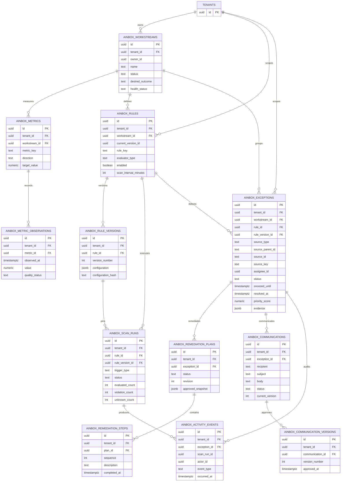

# Action Inbox entity relationship diagram

**Status:** Logical ERD based on `20261123_01_ainbox_foundation.sql` and subsequent Action Inbox migrations. The diagram omits many secondary indexes and operational columns. Refer to migrations for executable schema.

## Cross-tenant integrity

Each Action Inbox table has a `tenant_id`. Parent-child relationships use composite `(tenant_id,id)` references where defined, and the tables have RLS enabled. Direct browser table privileges are revoked. This is defense in depth, not proof that all RPC paths are safe; negative tests remain necessary.

## External source references

Work Board items are nested in `boards.data` JSONB and are referenced logically by board ID and item ID, not a physical item FK. Knowledge articles and portfolio initiatives are similarly referenced through `source_type`, `source_parent_id`, `source_id` and `source_key`; these references require adapter-level validation and source-specific access checks. Do not infer referential enforcement from the diagram.

## Lifecycle and uniqueness

The intended invariant is one unresolved exception per tenant, rule and canonical source key. Verified compliance sets `resolved_at` and allows a future violation to open a new occurrence. A dismissed exception remains unresolved until compliance is verified. Snooze is a timestamp overlay rather than a separate status.

## Schema sources

- `supabase/migrations/20261123_01_ainbox_foundation.sql`
- `supabase/migrations/20261123_03_ainbox_auth_rpc.sql`
- `supabase/migrations/20261123_04_ainbox_rules_engine.sql`
- `supabase/migrations/20261123_08_ainbox_workflows.sql`
- `supabase/migrations/20261123_09_ainbox_remediation.sql`
- `supabase/migrations/20261123_11_ainbox_item_done_status.sql`
