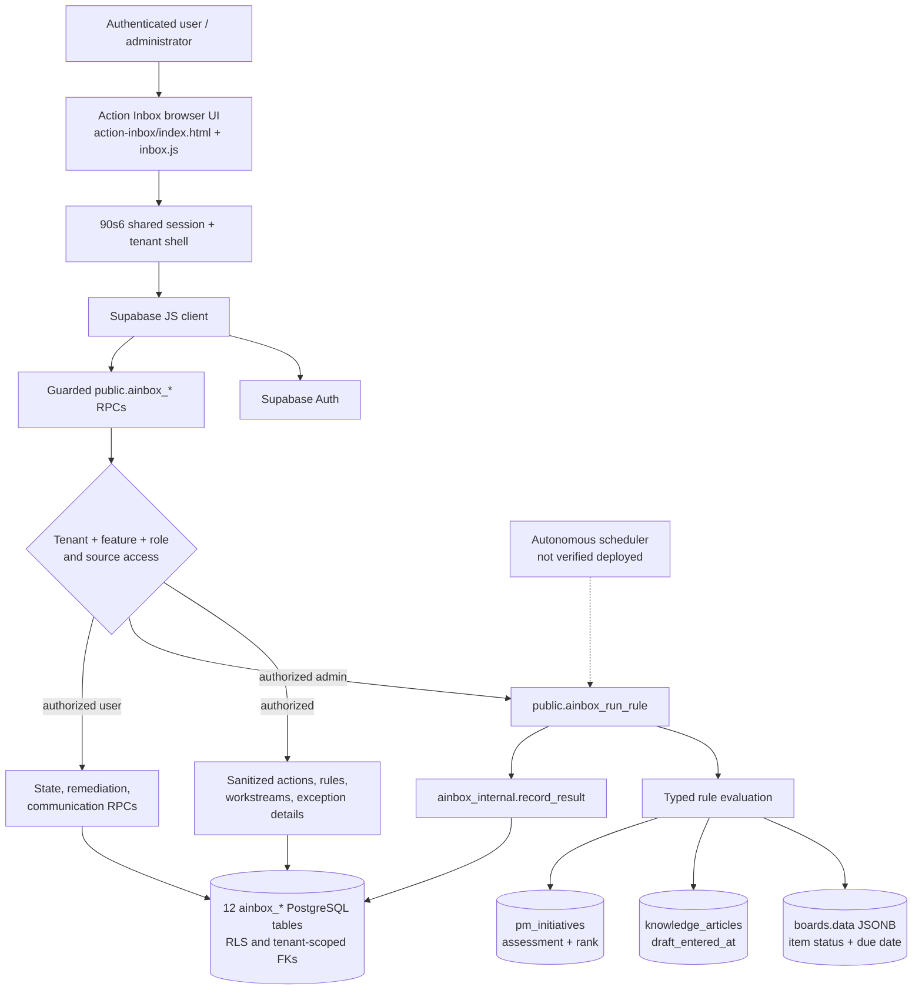
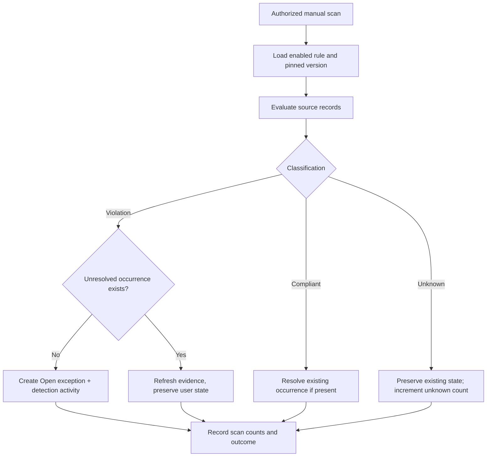

# Action Inbox system architecture

**Status:** As-implemented logical architecture, 2026-11-22. Read alongside [RFC-002](RFC-002-action-inbox-architecture.md). Solid arrows are implemented interactions; dashed arrows are planned or operationally unverified.

## Component diagram

## Rule evaluation and exception lifecycle

A scan's **evaluated**, **violations** and **unknown** counters are distinct. Unknown is not a failed scan and not an indication that the record is compliant. The current Work Board rule uses item-level Done status, not board column identity.

## Trust boundaries

1. **Browser boundary:** The UI may display and request actions, but it does not enforce authorization.
2. **RPC boundary:** `ainbox_authorized` checks user, tenant, feature and management role. `ainbox_source_visible` separately checks underlying source visibility.
3. **Evaluator boundary:** Trusted SQL scans and reconciles records, with restricted direct table access and append-only activity history.
4. **Source boundary:** Source apps own their records. Action Inbox records exceptions and guidance, not source mutations.

## Deployment and known gaps

The application is delivered from the 90s6 repository and uses the production Supabase project. Initial production rollout enabled the 90s6 organization. A manual rule scan is available; autonomous scheduling, complete partial-scan recovery, robust health metrics and comprehensive authorization regression testing remain outstanding. Do not depict those as operational services without subsequent verification.

## Related

- [Action Inbox ERD](action-inbox-erd.md)
- [RFC-002](RFC-002-action-inbox-architecture.md)
- [Existing platform diagram](system-architecture.md)
- [Architecture decision records](adr/README.md)
