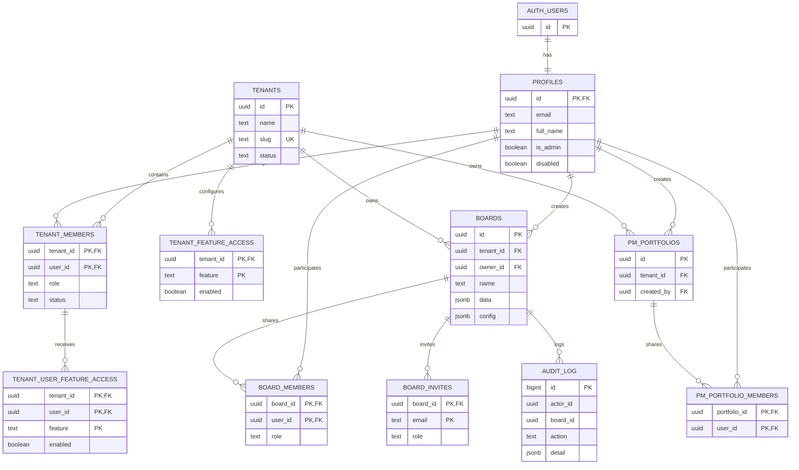

# Data model and entity relationship diagram

**Status:** Logical ERD derived from `supabase/setup.sql` and tenant/authorization migrations. This is not a full generated catalog of every production table.

## Modeling notes
- `AUTH_USERS` represents `auth.users`, managed by Supabase Auth. The other entities shown are application-side tables.
- Composite primary keys are represented by repeated `PK` annotations.
- `BOARDS.data` contains work items as JSONB; `BOARDS.config` contains board layout/configuration. Individual work items and columns therefore are **not** separately modeled as relational tables in this baseline.
- `PM_PORTFOLIOS` and `PM_PORTFOLIO_MEMBERS` are shown as logical entities because portfolio membership and tenant-scoped authorization are referenced in migrations; inspect their defining migrations for complete columns.
- The `AUDIT_LOG` association is logical; the baseline setup records `board_id` and actor information. Do not assume every audit event is associated with a board or that every actor reference is a declared FK.
- Content Studio, courses, prompts, knowledge articles, portfolio scoring and sharing-link storage are **not exhaustively enumerated** in this diagram. Extend from their authoritative DDL before using this as a migration specification.
- A foreign key or tenant identifier alone does not guarantee isolation. RLS policies, guarded functions, invitation acceptance and resource tenant immutability are part of the data security model.

## Sources of truth
`supabase/setup.sql`; `supabase/migrations/20261121_organization_tenant_foundation.sql`; `20261122_tenant_application_permissions.sql`; `20261122_tenant_board_portfolio_rls.sql`; and subsequent migrations.

## Action Inbox extension

The twelve tenant-scoped `ainbox_*` tables and their relationships are documented in the [Action Inbox ERD](action-inbox-erd.md). Work Board item references remain logical references into `boards.data` JSONB. The source of truth for the Action Inbox schema is its migration series.
