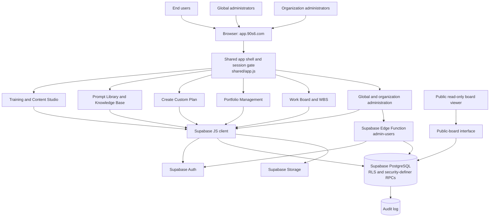

# System architecture

**Status:** Repository-based baseline, 2026-11-21. **Scope:** app.90s6.com, not the marketing site.

## Purpose
90s6 connects learning, reusable knowledge, planning, prioritization and execution in one authenticated workspace.

## System context and logical components

The diagram is logical: it does not assert a particular CDN, web host, storage bucket or production deployment topology.

## Browser application
The repository contains page-oriented HTML/JavaScript modules and a shared application shell. The shell initializes the Supabase client from `shared/config.js`, manages sign-in and profile state, tracks active organization context, and computes feature visibility. The primary product areas are Training, Content Studio, Prompt Library, Knowledge Base, Create Custom Plan, Work Board/WBS and Portfolio Management.

## Identity, tenants and permissions
- Supabase Auth provides identities; `public.profiles` stores application profile and global administrator/disabled state.
- `tenants` and `tenant_members` represent organizations and memberships. Membership roles include `tenant_admin`, `superuser` and `user`; a person can belong to multiple tenants.
- The active tenant is selected in the browser and must never be treated as sufficient authorization on its own.
- `tenant_feature_access` and `tenant_user_feature_access` provide organization-level and per-member application entitlements.
- PostgreSQL RLS and guarded RPC functions are the server-side security boundary. Browser navigation/feature hiding is convenience, not enforcement.
- Board and portfolio access also depends on resource ownership and sharing memberships.
- Public board sharing is a separately constrained read-only surface; inspect the public-link migration and policies before modifying exposure.

## Principal data flows
1. Sign-in: browser -> Supabase Auth -> profile and tenant membership lookup -> selected tenant -> authorized app.
2. Resource action: page -> Supabase client -> PostgreSQL RLS/RPC -> tenant-scoped board, portfolio or content resource.
3. Administration: authorized admin UI -> protected RPC or Edge Function -> identity/membership/entitlement changes -> audit as implemented.
4. Public board: anonymous viewer -> public board surface -> restricted read-only access path.

## Operational boundaries and verification
- Confirm the deployed database migrations, RLS policies and function grants independently of this diagram.
- Keep service-role credentials server-side; never expose them through browser configuration.
- Test cross-tenant reads, writes, invitations, exports, public links and bulk administration with negative authorization cases.
- Inspect CI workflows and hosting configuration separately before documenting a specific deployment provider, rollback SLA or backup retention.

## Action Inbox extension

Action Inbox adds exception detection, manual business-rule scans, remediation, communications and activity auditing to the shared application shell. It evaluates Work Board, Knowledge Base and Portfolio records without taking ownership of those source records. Its detailed [component and lifecycle diagrams](action-inbox-system.md) and [RFC-002](RFC-002-action-inbox-architecture.md) document the implementation and operational gaps.
